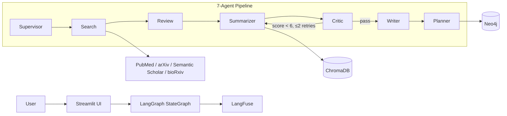
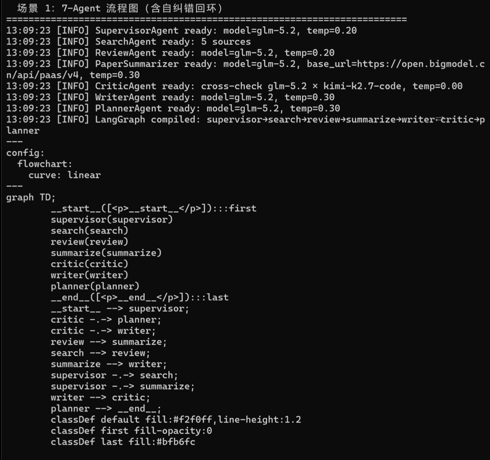
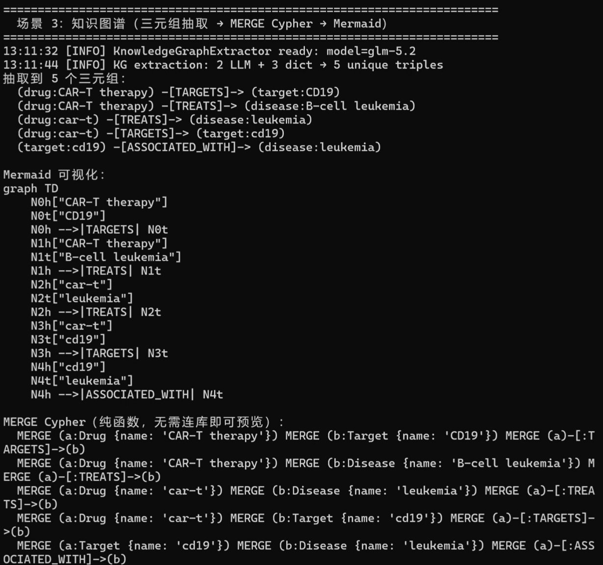
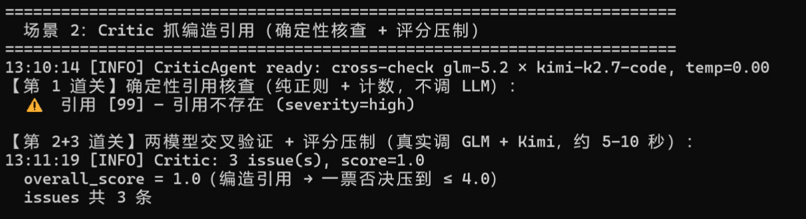
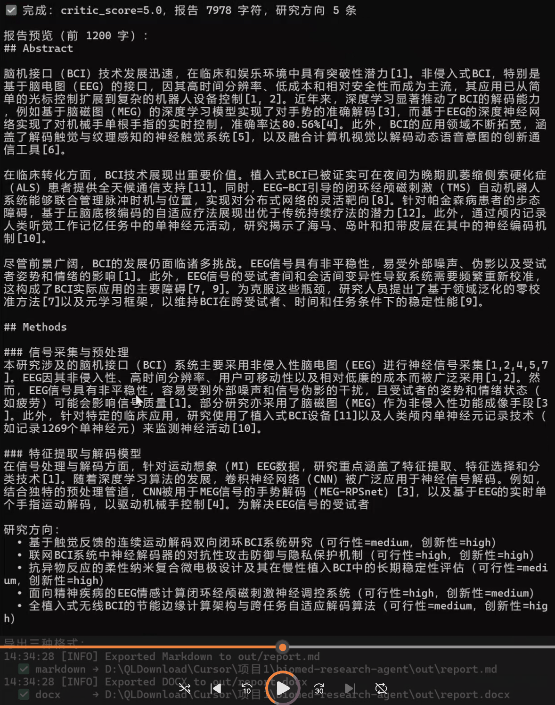
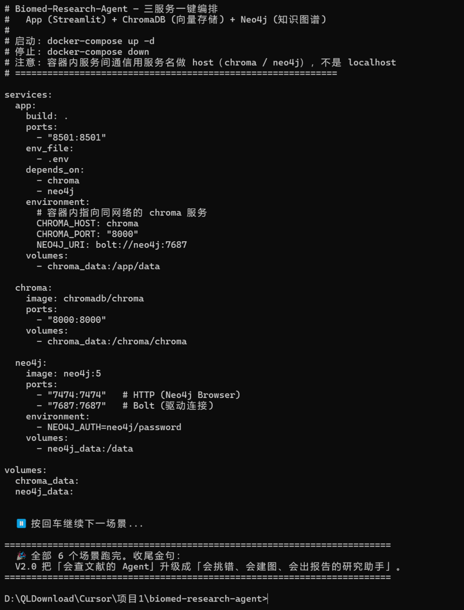
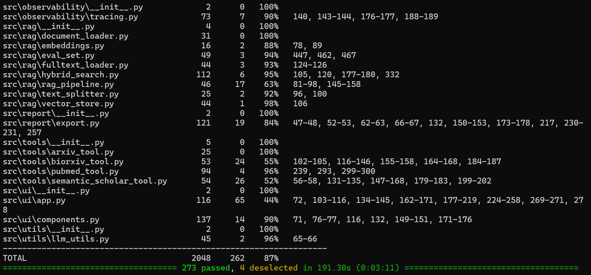

# Biomedical Research Agent

[](LICENSE)
[](https://www.python.org/downloads/)
[](https://www.docker.com/)

An AI-powered **multi-agent research assistant** for biomedical literature. It turns a single
research question into a structured, citation-backed literature review — then goes one step
further and proposes *what to study next*.

Built with **LangChain + LangGraph** orchestration, **ChromaDB** vector retrieval, and a
**7-agent** pipeline that cross-validates its own output to suppress hallucination.

> 中文文档见 [README.zh-CN.md](README.zh-CN.md)

---

## What makes it different

- **7 specialized agents** — not one giant prompt. `Supervisor` → `Search` → `Review` →
  `Summarizer` ⇄ `Critic` → `Writer` → `Planner`, orchestrated as a state graph with
  conditional routing.
- **Self-correcting loop** — the `Critic` grades each draft and sends it back to the
  `Summarizer` for rewrite until it passes (bounded, max 2 rewrites).
- **Deterministic citation checking** — fabricated `[n]` references are caught by plain
  regex + counting, *not* by an LLM, so a `[9]` with only 4 sources is always flagged.
- **Cross-model validation** — the Critic uses two different vendors (GLM + Kimi) as a
  genuine second opinion.
- **Knowledge graph** — extracts drug–target–disease triples and writes them to **Neo4j**
  (MERGE-based, idempotent).
- **Full-text RAG** — parses PDF full text via **PyMuPDF** (with Unstructured.io fallback)
  instead of abstract-only retrieval.
- **Report export** — Markdown / PDF / Word in one call, with BibTeX references.
- **Observability** — **LangFuse** tracing of every agent node (silently degrades to no-op
  without keys).
- **Docker** — one-command, three-service deployment (app + ChromaDB + Neo4j).

---

## Architecture



| Layer | Technology |
|-------|-----------|
| Agent framework | LangChain + LangGraph (StateGraph) |
| Vector database | ChromaDB |
| Embeddings | Sentence-Transformers (PubMedBERT) |
| Knowledge graph | Neo4j |
| UI | Streamlit |
| API | FastAPI + Uvicorn |
| Data sources | PubMed, arXiv, Semantic Scholar, bioRxiv |
| Observability | LangFuse |
| Infrastructure | Docker + docker-compose |

---

## Features

- 🔍 **Multi-source search** — PubMed, arXiv, Semantic Scholar, bioRxiv, queried concurrently.
- 🧬 **Biomedical embeddings** — PubMedBERT for domain-tuned retrieval, with hybrid
  (dense + BM25) search.
- 🤖 **7-agent orchestration** — specialist agents with a typed shared state.
- 🛡️ **Critic + self-correction** — cross-model validation, fact-checking, and deterministic
  citation verification.
- 🕸️ **Knowledge graph** — drug / target / disease / gene triple extraction → Neo4j.
- 📄 **Full-text PDF parsing** — PyMuPDF first, Unstructured.io fallback, scanned-PDF guard.
- 🔗 **Citation traceability** — every report claim links back to a real `[n]` source with
  clickable PMIDs in the UI.
- 📊 **Structured report** — Abstract / Methods / Findings / Gaps / Directions / References.
- 🧭 **Research direction planner** — turns gaps into testable hypotheses with
  feasibility + novelty scoring.
- 📦 **Report export** — Markdown / PDF / Word, plus BibTeX.
- 📈 **Observability** — LangFuse tracing of the whole agent call chain.
- 🐳 **Docker** — reproducible 3-service stack.

---

## Screenshots

<table>
  <tr>
    <td width="50%"><br/><em>7-agent pipeline</em></td>
    <td width="50%"><br/><em>Neo4j knowledge graph (drug–target–disease)</em></td>
  </tr>
  <tr>
    <td width="50%"><br/><em>Critic scoring &amp; self-correction</em></td>
    <td width="50%"><br/><em>Report export (Markdown / PDF / Word)</em></td>
  </tr>
  <tr>
    <td width="50%"><br/><em>Docker three-service deployment</em></td>
    <td width="50%"><br/><em>Test coverage report</em></td>
  </tr>
</table>

---

## Quick Start

### Option A — Docker (recommended)

```bash
git clone git@github.com:jsidj306/Biomed-Research-Agent.git
cd Biomed-Research-Agent
cp .env.example .env        # fill in your API keys
docker-compose up -d        # app + chroma + neo4j
# open http://localhost:8501
```

### Option B — local (uv)

```bash
git clone git@github.com:jsidj306/Biomed-Research-Agent.git
cd Biomed-Research-Agent
uv sync
cp .env.example .env        # edit with your API keys
uv run streamlit run src/ui/app.py
```

See [docs/deployment.md](docs/deployment.md) for full deployment details (Neo4j setup,
HuggingFace Spaces, etc.).

---

## Environment variables

Copy `.env.example` → `.env`:

| Variable | Required | Purpose |
|----------|----------|---------|
| `NCBI_API_KEY` / `NCBI_EMAIL` | Yes | PubMed / NCBI E-utilities |
| `ZHIPU_API_KEY` | Yes | 智谱 GLM（主审 / 默认模型） |
| `MOONSHOT_API_KEY` | Yes | 月之暗面 Kimi（Critic 交叉验证第二意见） |
| `SEMANTIC_SCHOLAR_API_KEY` | Optional | Semantic Scholar (rate limit without key) |
| `LANGFUSE_PUBLIC_KEY` / `LANGFUSE_SECRET_KEY` / `LANGFUSE_HOST` | Optional | LLM observability |

---

## Usage

```python
from src.agents.graph import build_graph

app = build_graph()
result = app.invoke({"query": "CAR-T therapy for solid tumors"})

print(result["report"])        # six-section literature review
print(result["directions"])    # research directions with hypotheses
```

```python
# Knowledge graph
from src.knowledge_graph.extractor import KnowledgeGraphExtractor
from src.knowledge_graph.neo4j_writer import Neo4jWriter

triples = KnowledgeGraphExtractor().extract_triples("CAR-T therapy treats B-cell leukemia...")
Neo4jWriter(uri="bolt://localhost:7687").write_triples(triples)
```

```python
# Report export
from src.report.export import export_report
export_report(report, "out/report.md", fmt="markdown")
export_report(report, "out/report.docx", fmt="docx")
export_report(report, "out/report.pdf", fmt="pdf")
```

---

## Testing

```bash
uv run pytest                    # full suite
uv run pytest -m "not slow"      # skip PubMedBERT download tests
uv run ruff check src/ tests/    # lint
```

Coverage is tracked against a ≥70% gate; see [docs/CONTRIBUTING.md](docs/CONTRIBUTING.md).

---

## Project structure

```
src/
├── agents/            # 7 agents + LangGraph orchestration (graph.py)
│   ├── supervisor.py  #   plan decomposition
│   ├── search_agent.py#   multi-source search
│   ├── review_agent.py#   relevance scoring
│   ├── summarizer.py  #   summarization + gap analysis
│   ├── critic_agent.py#   cross-validation + citation check
│   ├── writer_agent.py#   structured report + BibTeX
│   └── planner_agent.py#  research direction recommendation
├── knowledge_graph/   # triple extraction + Neo4j writer
├── rag/               # vector store, hybrid search, full-text loader
├── report/            # Markdown/PDF/Word exporters
├── tools/             # PubMed / arXiv / Semantic Scholar / bioRxiv clients
├── ui/                # Streamlit app + components
├── observability/     # LangFuse tracing
└── utils/             # LLM helpers (retry + JSON fault tolerance)
```

---

## Demo & Blog

- 🎬 [V1.0 multi-agent demo (5–8 min)](docs/demo/v1_demo.mp4) — Supervisor dispatch → 5-source
  concurrent search → review scoring → summarization, with hybrid retrieval eval and LangFuse
  tracing.
- 📝 [From MiniMind to LangGraph — building a biomedical research agent](https://juejin.cn/spost/7673780779483676678) (掘金)
- 📝 [Adding a picky reviewer to an agent — the Critic and self-correction loop](https://juejin.cn/post/7674130372750295082) (掘金)
- 📝 [Building a biomedical knowledge graph with LLM + Neo4j](https://juejin.cn/post/7674123634785828900) (掘金)
- 📝 [From research to deliverable — report generation, export, and containerization](https://juejin.cn/post/7674130372750360618) (掘金)

---

## Roadmap

- **V1.0** — 4-agent linear pipeline (search → review → summarize), ChromaDB RAG, Streamlit UI.
- **V2.0** — 7 agents, self-correcting Critic loop, knowledge graph, full-text parsing,
  citation traceability, report export, Docker. ← *current*

---

## License

[MIT](LICENSE)
