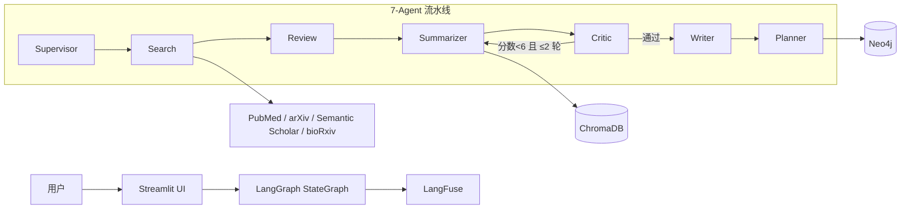

# Biomedical Research Agent（生物医学研究 Agent）

[](LICENSE)
[](https://www.python.org/downloads/)
[](https://www.docker.com/)

一个面向生物医学文献的 **AI 多 Agent 研究助手**。你把一个研究问题交给它，它返回一份带
引用溯源的结构化文献综述，并进一步告诉你——**下一步该研究什么**。

基于 **LangChain + LangGraph** 编排、**ChromaDB** 向量检索，通过 **7 个专职 Agent**
流水线协作，并对自身输出做交叉验证以抑制幻觉。

> English docs: [README.md](README.md)

---

## 为什么与众不同

- **7 个专职 Agent**——不是一个大 prompt。`Supervisor` → `Search` → `Review` →
  `Summarizer` ⇄ `Critic` → `Writer` → `Planner`，用状态图 + 条件路由编排。
- **自纠错闭环**——`Critic` 给初稿打分，不达标就退回 `Summarizer` 重写，直到通过
  （有上限，最多返工 2 轮，防死循环）。
- **确定性引用核查**——编造的 `[n]` 引用用纯正则 + 计数抓，不靠 LLM。只有 4 篇文献
  却出现 `[9]`，必然被标记为 high 严重度。
- **跨模型交叉验证**——Critic 用两家不同厂商（GPT + Claude）做真正的第二意见。
- **知识图谱**——抽取「药物-靶点-疾病」三元组写入 **Neo4j**（MERGE 幂等写入）。
- **全文级 RAG**——用 **PyMuPDF** 解析 PDF 全文（Unstructured.io 兜底），不再只读摘要。
- **报告导出**——一次调用导出 Markdown / PDF / Word，附 BibTeX 引用。
- **可观测性**——**LangFuse** 追踪每个 Agent 节点（无 Key 时静默降级为 no-op）。
- **Docker**——一条命令拉起三服务（app + ChromaDB + Neo4j）。

---

## 架构



| 层 | 技术 |
|-------|-----------|
| Agent 框架 | LangChain + LangGraph（StateGraph） |
| 向量库 | ChromaDB |
| 向量化 | Sentence-Transformers（PubMedBERT） |
| 知识图谱 | Neo4j |
| UI | Streamlit |
| API | FastAPI + Uvicorn |
| 数据源 | PubMed, arXiv, Semantic Scholar, bioRxiv |
| 可观测性 | LangFuse |
| 基础设施 | Docker + docker-compose |

---

## 功能

- 🔍 **多源检索**——PubMed、arXiv、Semantic Scholar、bioRxiv 并发查询。
- 🧬 **生物医学向量化**——PubMedBERT 领域调优检索 + 混合（稠密 + BM25）检索。
- 🤖 **7-Agent 编排**——专职 Agent + 类型化的共享状态。
- 🛡️ **Critic + 自纠错**——跨模型验证、事实核查、确定性引用核查。
- 🕸️ **知识图谱**——药物/靶点/疾病/基因 三元组抽取 → Neo4j。
- 📄 **PDF 全文解析**——PyMuPDF 优先、Unstructured.io 兜底、扫描版防护。
- 🔗 **引用溯源**——报告每个结论都关联真实 `[n]` 来源，UI 中 PMID 可点击跳转。
- 📊 **结构化报告**——摘要 / 方法 / 发现 / 空白 / 方向 / 参考文献 六段式。
- 🧭 **研究方向规划**——把研究空白转成可验证假设 + 可行性/创新性评分。
- 📦 **报告导出**——Markdown / PDF / Word + BibTeX。
- 📈 **可观测性**——LangFuse 追踪整条 Agent 调用链。
- 🐳 **Docker**——可复现的三服务部署。

---

## 快速开始

### 方式 A —— Docker（推荐）

```bash
git clone git@github.com:jsidj306/Biomed-Research-Agent.git
cd Biomed-Research-Agent
cp .env.example .env        # 填入你的 API Key
docker-compose up -d        # app + chroma + neo4j
# 打开 http://localhost:8501
```

### 方式 B —— 本地（uv）

```bash
git clone git@github.com:jsidj306/Biomed-Research-Agent.git
cd Biomed-Research-Agent
uv sync
cp .env.example .env        # 编辑填入你的 API Key
uv run streamlit run src/ui/app.py
```

完整部署细节（Neo4j 安装、HuggingFace Spaces 等）见
[docs/deployment.md](docs/deployment.md)。

---

## 环境变量

复制 `.env.example` → `.env`：

| 变量 | 必填 | 用途 |
|----------|----------|---------|
| `NCBI_API_KEY` / `NCBI_EMAIL` | 是 | PubMed / NCBI E-utilities |
| `OPENAI_API_KEY` | 是 | 主 LLM（兼容 OpenAI 的 base URL） |
| `ANTHROPIC_API_KEY` | 可选 | 跨模型验证（Critic 的第二意见） |
| `SEMANTIC_SCHOLAR_API_KEY` | 可选 | Semantic Scholar（无 Key 有速率限制） |
| `LANGFUSE_PUBLIC_KEY` / `LANGFUSE_SECRET_KEY` / `LANGFUSE_HOST` | 可选 | LLM 可观测性 |

---

## 使用示例

```python
from src.agents.graph import build_graph

app = build_graph()
result = app.invoke({"query": "CAR-T therapy for solid tumors"})

print(result["report"])        # 六段式文献综述
print(result["directions"])    # 含假设的研究方向
```

```python
# 知识图谱
from src.knowledge_graph.extractor import KnowledgeGraphExtractor
from src.knowledge_graph.neo4j_writer import Neo4jWriter

triples = KnowledgeGraphExtractor().extract_triples("CAR-T therapy treats B-cell leukemia...")
Neo4jWriter(uri="bolt://localhost:7687").write_triples(triples)
```

```python
# 报告导出
from src.report.export import export_report
export_report(report, "out/report.md", fmt="markdown")
export_report(report, "out/report.docx", fmt="docx")
export_report(report, "out/report.pdf", fmt="pdf")
```

---

## 测试

```bash
uv run pytest                    # 全量测试
uv run pytest -m "not slow"      # 跳过 PubMedBERT 下载测试
uv run ruff check src/ tests/    # 代码风格检查
```

覆盖率门槛 ≥70%；详见 [docs/CONTRIBUTING.md](docs/CONTRIBUTING.md)。

---

## 项目结构

```
src/
├── agents/            # 7 个 Agent + LangGraph 编排（graph.py）
│   ├── supervisor.py  #   研究步骤规划
│   ├── search_agent.py#   多源检索
│   ├── review_agent.py#   相关性评分
│   ├── summarizer.py  #   摘要 + 研究空白分析
│   ├── critic_agent.py#   交叉验证 + 引用核查
│   ├── writer_agent.py#   结构化报告 + BibTeX
│   └── planner_agent.py#  研究方向推荐
├── knowledge_graph/   # 三元组抽取 + Neo4j 写入
├── rag/               # 向量库、混合检索、全文加载
├── report/            # Markdown/PDF/Word 导出
├── tools/             # PubMed / arXiv / Semantic Scholar / bioRxiv 客户端
├── ui/                # Streamlit 应用与组件
├── observability/     # LangFuse 追踪
└── utils/             # LLM 工具（重试 + JSON 容错）
```

---

## 演示与博客

- 🎬 [V1.0 多 Agent 编排演示（5–8 分钟）](docs/demo/v1_demo.mp4)——Supervisor 派单 →
  5 源并发搜索 → Review 评分 → 摘要输出，含混合检索评测与 LangFuse 追踪。
- 📝 [从 MiniMind 到 LangGraph——构建生物医学研究 Agent](https://juejin.cn/spost/7673780779483676678)（掘金）

---

## 路线图

- **V1.0** — 4-Agent 线性流水线（搜索 → 评审 → 摘要）、ChromaDB RAG、Streamlit UI。
- **V2.0** — 7 Agent、Critic 自纠错回环、知识图谱、全文解析、引用溯源、报告导出、
  Docker。← *当前版本*

---

## License

[MIT](LICENSE)
