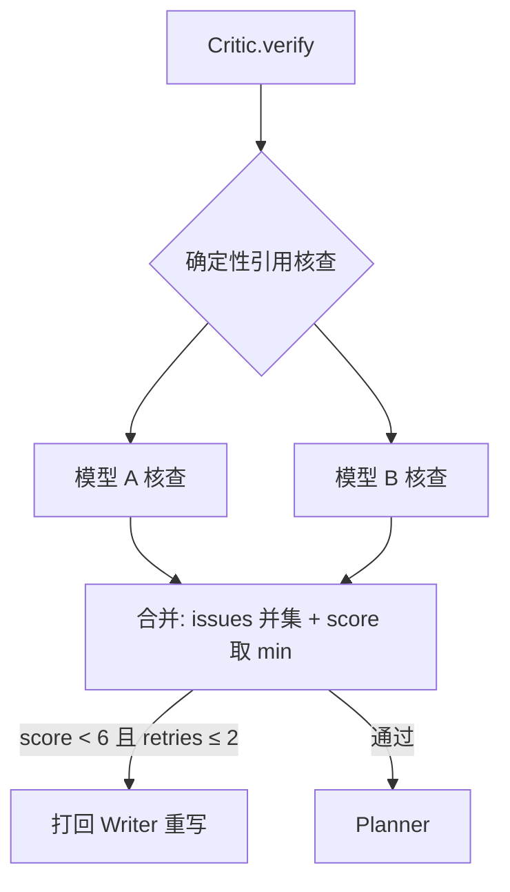
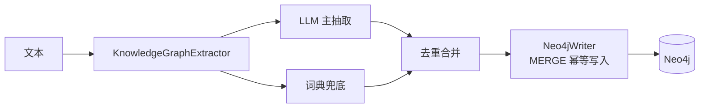
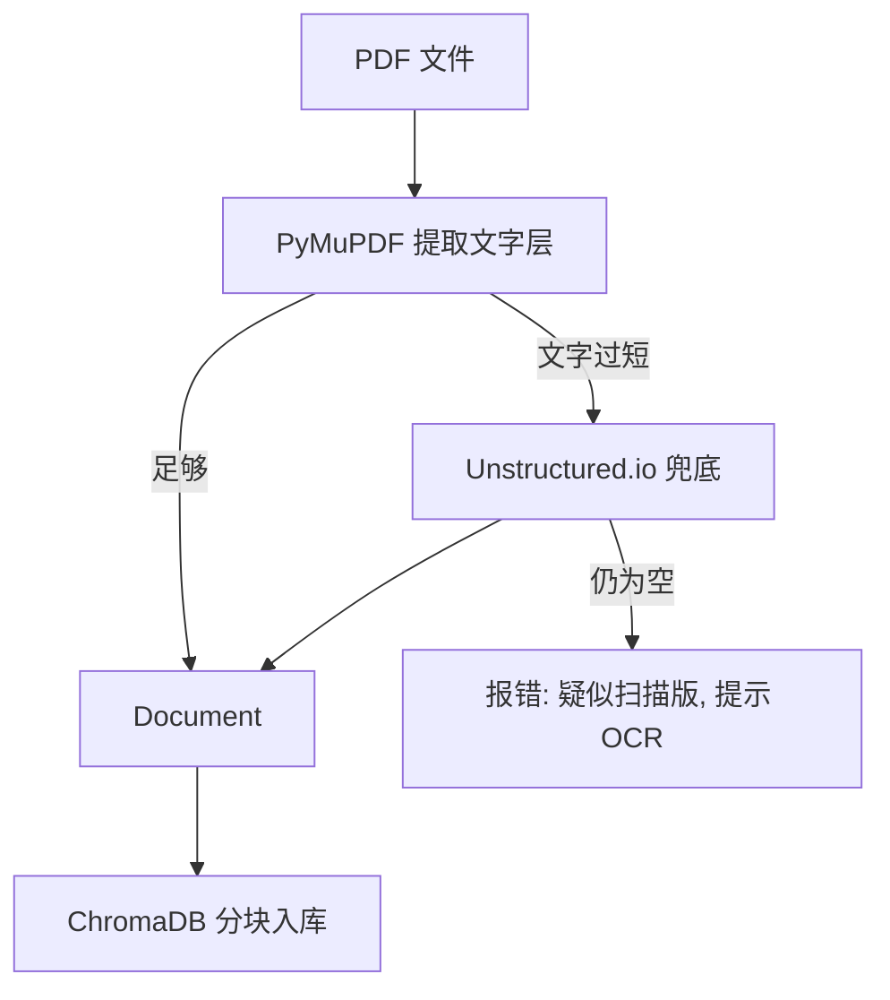

# 架构设计（Architecture）

本文档描述 Biomedical Research Agent 的 V2.0 架构：7-Agent 编排、自纠错回环、
知识图谱、全文 RAG 与可观测性。

---

## 1. 总体架构

```
用户 → Streamlit UI → LangGraph StateGraph（7-Agent 流水线）
                              ├── 多源检索（PubMed/arXiv/Semantic Scholar/bioRxiv）
                              ├── RAG（ChromaDB 混合检索）
                              ├── 知识图谱（Neo4j）
                              └── 报告导出（Markdown/PDF/Word）
```

核心原则：**单一数据流 + 类型化共享状态 + 节点纯函数**。每个 Agent 是「输入状态 →
返回部分状态更新」的纯函数，由 LangGraph 负责调度、条件路由与状态合并。这使得每个
节点都能被单独 mock 测试，不需要真实 LLM / API。

---

## 2. 7-Agent 编排图

```mermaid
graph TD
    START((__start__)) --> SUP[Supervisor<br/>规划研究步骤]
    SUP -->|plan 非空| SE[Search<br/>多源并发检索]
    SUP -->|plan 为空| SU[Summarizer]
    SE --> RV[Review<br/>相关性评分]
    RV --> SU[Summarizer<br/>摘要 + 空白分析]
    SU --> WR[Writer<br/>六段式报告，含 [n] 引用]
    WR --> CR[Critic<br/>交叉验证 + 引用核查]
    CR -->|分数 < 6 且 ≤2 轮返工| WR
    CR -->|通过| PL[Planner<br/>研究方向推荐]
    PL --> END((END))
```

各 Agent 职责：

| Agent | 文件 | 职责 |
|-------|------|------|
| Supervisor | `src/agents/supervisor.py` | 把研究问题拆成可执行步骤（plan） |
| Search | `src/agents/search_agent.py` | 并发检索 PubMed/arXiv/Semantic Scholar/bioRxiv |
| Review | `src/agents/review_agent.py` | 按相关性给检索结果打分排序 |
| Summarizer | `src/agents/summarizer.py` | 逐篇摘要 + Gap Analysis（研究空白） |
| Critic | `src/agents/critic_agent.py` | 交叉验证 + 事实核查 + 确定性引用核查 |
| Writer | `src/agents/writer_agent.py` | 组装六段式报告 + BibTeX |
| Planner | `src/agents/planner_agent.py` | 把研究空白转成可验证假设 + 可行性/创新性评分 |

---

## 3. 共享状态（AgentState）

所有节点通过一个类型化的 `TypedDict` 状态交接，避免「全局变量 + 传参地狱」：

```python
class AgentState(TypedDict, total=False):
    query: str            # 用户原始问题
    plan: list[str]       # Supervisor 生成的步骤
    papers: list[dict]    # Search 检索结果
    reviews: list[dict]   # Review 相关性评分
    summaries: dict       # Summarizer 摘要
    gaps: list[Any]       # 研究空白（gap analysis）
    final_report: str     # 初步报告（Summarize 汇总，供 UI 预览）
    critic_score: float   # Critic 综合评分（0-10）
    critic_issues: list[dict]  # Critic 问题清单
    critic_retries: int   # 已返工轮数
    report: str           # 最终六段式报告（Writer）
    directions: list[dict]# 研究方向（Planner）
```

---

## 4. 自纠错回环（Self-correction）

Critic 是「挑错」的 Agent，不产出新内容。它做三道质检：

1. **确定性引用核查**（`check_citations`）——纯正则 `\[(\d+)\]` + 计数，报告里的 `[n]`
   超出 `len(sources)` 即判 high 严重度。**这一步不用 LLM**，是「编造引用必被抓」的
   最强保证。
2. **两模型交叉验证**——`llm_a`（GPT）与 `llm_b`（Claude）独立核查，合并时
   - issues 取**并集**（任一模型揪出的问题都算问题）
   - 评分取**更严格的一方**（`min`），两模型都高分才算通过
3. **评分压制**——一旦出现 high 严重度引用问题，评分直接压到 ≤ 4.0（不及格）。



防死循环：`MAX_CRITIC_RETRIES = 2`，返工上限内 Critic 最多跑 3 轮。

---

## 5. 知识图谱

`src/knowledge_graph/` 负责把生物医学文本转成「药物-靶点-疾病」三元组：



- **实体类型**：drug / target / disease / gene
- **关系**：`TREATS` / `TARGETS` / `ASSOCIATED_WITH` / `ENCODES` / `IMPLICATED_IN`
- **写入策略**：用 `MERGE` 而非 `CREATE`，先查重再建节点，重复写入不产生重复实体。
- **解耦**：`build_cypher` 是纯函数（无驱动即可测试），`write_triples` 才真正连 Neo4j。

---

## 6. 全文 RAG

`src/rag/fulltext_loader.py` 提供「全文级」检索能力：



- 分块参数：`chunk_size=1500`、`chunk_overlap=300`
- 扫描版（图片型）PDF 提取为空时明确报错，不静默产生垃圾数据。

---

## 7. 可观测性（LangFuse）

`src/observability/tracing.py` 用 `LangfuseTracer` 给每个 Agent 节点包一层 trace span，
记录输入/输出/异常。关键设计原则——**监控是旁路功能**：

- 未安装 / 未配置 Key / 网络异常 → 一律静默降级为 no-op
- 所有 trace 调用都用 try/except 包裹，失败只记日志，绝不拖垮主流程

---

## 8. 容错与重试

所有 LLM 调用统一走 `src/utils/llm_utils.py`：

- `tenacity @retry`：3 次重试 + 指数退避（min=2s，max=10s）
- `parse_json_response`：3 级 JSON 容错（围栏剥离 → 直接解析 → 提取首段 JSON）
- 每个 Agent 的 LLM 失败都降级为「空结果 + warning 日志」，不中断主流程
