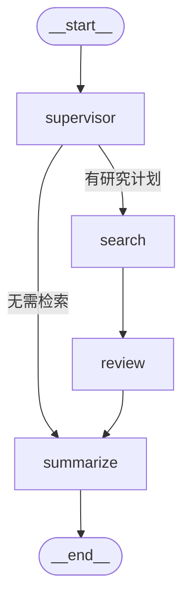

# 从 MiniMind 到 LangGraph——构建生物医学研究 Agent

> 这是「Biomed-Research-Agent」项目的第一篇技术复盘。
> 从一个手搓的小模型（MiniMind），到一个能自主规划、多源检索、交叉评审的多 Agent 系统，
> 记录我踩过的坑、做对的决策，以及接下来想做的事。

---

## 一、背景与动机：为什么做这件事

生物医学研究者的日常，是反复在做同一件「费脑子」的事：

> 输入一个研究问题 → 搜一堆论文 → 判断哪些相关 → 读摘要 → 提炼结论 → 找出空白。

这个过程里，真正有创造性的部分（提出假设、设计实验）只占 20%，剩下 80% 是机械的信息收集与整理。而「机械的信息收集」，恰好是 LLM 最擅长的事。

我的上一阶段是在做 **MiniMind**——一个从零实现的小型语言模型，目标是理解 Transformer 的每一层在干什么。那个项目让我搞懂了「一个模型是怎么被训练出来的」。而这一次，我想换个角度：**不再手搓模型，而是学会「编排」现有的大模型，让它们像团队一样协作。**

题目里的「生物医学」也不是随便选的。生物医学文献有几个特点，让它成为检验 Agent 能力的绝佳战场：

1. **术语高度专业**——基因名、药物名、缩写，精确匹配和语义理解缺一不可；
2. **数据源分散**——PubMed、arXiv、Semantic Scholar、bioRxiv、medRxiv，各管一摊；
3. **结论经常打架**——同一药物，A 论文说有效、B 论文说无效，需要主动识别矛盾；
4. **信息过载严重**——一次搜索几百篇，人根本读不过来。

一个能把「检索 → 评审 → 摘要」串起来的 Agent，在这里有真实价值。

---

## 二、架构演进：从单链到多 Agent

### 2.1 MVP：一条线性流水线

第一版（MVP，第 1-2 周）做的是把「搜索 → 检索 → 摘要」串成一条链：

```
用户提问 → PubMed/Arxiv 搜索 → RAG 语义检索 → LLM 摘要 → 结构化输出
```

这条路是通的，86 个测试、82% 覆盖率，Streamlit 界面也能跑。但它有个根本问题：**它是「固定流水线」**。不管用户问什么，都走完全一样的四步——即使有些问题根本不需要检索，或者需要先拆解成多个子问题。

打个比方：MVP 是一条工厂流水线，而真正的科研是「一个主管带着几个专家开会」。

### 2.2 V1.0：一个有主管的多 Agent 团队

第 3-4 周，我用 **LangGraph** 把流水线升级成了一张「有状态、可条件路由」的图：



四个专职 Agent 各司其职：

| Agent | 职责 | 类比 |
|-------|------|------|
| **Supervisor** | 意图解析 + 拆解研究步骤 | 项目经理 |
| **Search** | 5 数据源并发检索 | 检索专员 |
| **Review** | 相关性评分 + 去重 + 矛盾检测 | 审稿人 |
| **Summarize** | 5 种摘要模式 | 分析师 |

关键升级是**条件边**（conditional edge）：Supervisor 拆出计划后，判断「需要检索」还是「直接总结」，把流程从「固定流水线」升级成「自适应编排」。

---

## 三、关键技术点

### 3.1 LangGraph StateGraph：用「图」描述 Agent 协作

LangGraph 的核心就三个概念：**State**（贯穿所有节点的共享状态）、**Node**（处理函数）、**Edge**（状态流转）。跟普通 LangChain 链的区别是，它用「图」描述跳转逻辑，天然支持循环和条件分支。

```python
from typing import TypedDict
from langgraph.graph import StateGraph, END, START

class AgentState(TypedDict, total=False):
    query: str          # 用户原始问题
    plan: list[str]     # 研究步骤计划
    papers: list[dict]  # 检索结果
    reviews: list[dict] # 相关性评分
    final_report: str   # 最终输出

graph = StateGraph(AgentState)
graph.add_node("supervisor", supervisor_node)
graph.add_node("search", search_node)
graph.add_node("review", review_node)
graph.add_node("summarize", summarize_node)

graph.add_edge(START, "supervisor")
graph.add_conditional_edges(
    "supervisor", route_after_supervisor,
    {"search": "search", "summarize": "summarize"},
)
graph.add_edge("search", "review")
graph.add_edge("review", "summarize")
graph.add_edge("summarize", END)

app = graph.compile()
```

这里我踩的第一个坑：**State 一定要用 TypedDict 而不是普通 dict**。多 Agent 之间唯一的「交接界面」就是 State，用 TypedDict 加类型约束，IDE 能自动补全、拼错字段名会直接报错。否则五个 Agent 协作时，一个字段名不统一的隐蔽 bug 能让你 debug 一晚上。

### 3.2 Supervisor：规划与执行分离

Supervisor 不亲自搜文献，它只做两件事：**判断意图**、**拆解计划**。

```python
def generate_plan(self, query: str) -> list[str]:
    data = self._call_llm(PLAN_PROMPT.format(query=query))
    return [s for s in data.get("plan", []) if s]
```

一个容易被忽略的细节：**Supervisor 用低温度（temperature=0.2）**。计划生成需要「稳定、可复现」，不像创意写作。低温度让模型几乎每次都给出相同的拆解，测试好断言、演示不翻车。

### 3.3 混合检索：语义 + BM25 + RRF + Reranker

纯语义检索（向量）擅长「意思相近但用词不同」，BM25 擅长「精确词匹配」。生物医学里基因名、药物名、缩写必须精确命中，所以单靠向量检索会漏。

我用 **RRF（Reciprocal Rank Fusion）** 把两路召回融合——方法极简，就是把名次倒数相加：

```python
def reciprocal_rank_fusion(rankings, k=60):
    scores = {}
    for ranking in rankings:
        for rank, doc_id in enumerate(ranking):
            scores[doc_id] = scores.get(doc_id, 0) + 1.0 / (k + rank + 1)
    return sorted(scores, key=scores.get, reverse=True)
```

最后再用 **BGE-Reranker** 做「粗排后的精排」：第一段从几万篇里粗召回 100 篇，第二段用更慢但更准的重排模型对这 100 篇精排。

### 3.4 LangFuse：让多 Agent 系统「可观测」

多 Agent 系统最大的痛点是「出问题只能瞎猜」。LangFuse 记录每一次调用的输入、输出、耗时、token 成本，还能看整个调用链的火焰图。

我在这里定了一条铁律：**监控是「旁路」功能，不能拖垮主流程**。所有 trace 调用都包在 try/except 里，LangFuse 挂了就静默降级。

```python
def record(self, name, input_data=None, output_data=None, duration_ms=None):
    if not self.enabled:
        return
    try:
        trace = self._client.trace(name=name, input=input_data, output=output_data)
        trace.update(metadata={"duration_ms": duration_ms})
    except Exception as e:
        logger.warning("LangFuse record failed (degraded): %s", e)
```

---

## 四、踩坑与心得

**1. 统一返回格式是最值的架构决策。** MVP 阶段就定了 `{papers, total_count, query, source}` 的统一协议。V1.0 把数据源从 2 个扩到 5 个，下游 Review/Summarize 一行不用改。前期多花半小时定协议，后面省一天。

**2. 标题相似度去重的阈值很难调。** 用 difflib 相似度 > 0.9 判重，太松会漏、太紧会误删。更麻烦的是，「Drug X effective」和「Drug X ineffective」这种结论相反、标题却只差一个词的论文，会被相似度误判成重复——这跟「矛盾检测」的目标直接冲突。测试要重点覆盖阈值边界。

**3. 测试 LLM 相关代码，永远 mock。** 所有依赖 LLM 的单元测试，都把 ChatOpenAI 换成返回固定 JSON 的假对象。既省 API 钱，又避免网络 flaky。这是测试 LLM 代码的标准做法。

**4. 降级策略是生产级 Agent 的基本素养。** 5 个数据源里某个限流了，不能让整个搜索失败；评分失败就给 0 分继续；监控挂了就静默。用 try/except 包住每个可能失败的点，保证不因单点故障崩溃。

**5. 别在 Windows 上搞符号链接。** PubMedBERT 的模型缓存因为 symlink 会大一圈，这是 Windows 环境的小坑，记一笔。

---

## 五、未来规划

V1.0 打通了「多 Agent 协作」的主干。第 5-6 周想做三件「增强」的事：

1. **Critic Agent**——给摘要加一个「审稿人」，专门挑毛病、验证结论，形成 self-refine 闭环；
2. **知识图谱**——把论文里的实体（基因/药物/疾病）抽出来建图，支持关系推理；
3. **报告生成**——把多轮研究的产物自动组装成一份结构化综述报告。

技术成长线也清晰了：MiniMind 让我懂「模型」，LangGraph 让我懂「编排」。下一步，是想懂「评估」——怎么证明一个 Agent 真的比另一个好。

---

*项目地址：[github.com/jsidj306/Biomed-Research-Agent](https://github.com/jsidj306/Biomed-Research-Agent)*
*2026-08-14*
