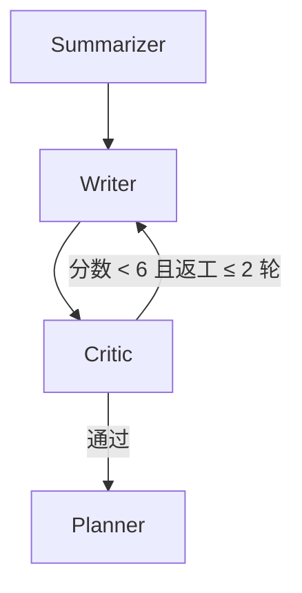

# 给 Agent 加一个「挑刺的审稿人」——Critic 与自纠错回环

> 这是「Biomed-Research-Agent」项目的第二篇技术复盘。
> 上一篇结尾我说「下一步想懂『评估』——怎么证明一个 Agent 真的比另一个好」。
> 这一篇，就是我给出的第一份答案：**别让生成者更聪明，给它配一个专门挑错的审稿人。**

---

## 一、问题：生成式 Agent 的天花板是「幻觉」

这篇文章的「挑刺」，针对的是 LLM 一个非常具体、也非常危险的毛病——**编造引用**。想象一份报告信誓旦旦地写「据研究 `[9]` 显示」，可那次一共只检索到 4 篇论文，`[9]` 根本不存在。

> 诚实说明：`[9]` 不是我在真实运行里抓到的个案，而是我为了逼出这个漏洞、故意写进单元测试里的攻击样本。但「引用可能被编造」这件事本身不是假设——它是 LLM 的固有毛病，值得专门设一道防线，这正是下面要讲的。

LLM 最大的问题从来不是「不够聪明」，而是「**自信地错**」。它编造引用时，语气和它说真话时一模一样，你根本分辨不出来。

这里有个关键认知：**生成和质检是两种完全不同的能力。** 让一个负责「写」的模型去「自我检查」，等于让犯人审自己的案子——它只会重复自己的错误。V1.0 的流水线里，Summarizer 既是运动员又是裁判，这正是漏洞所在。

所以 V2.0 我做了一件看起来「绕」、其实很本质的事：**新增一个 Critic Agent，它不产出任何新内容，只负责质疑和验证别人。**

---

## 二、Critic 的三道关：各防一类错

Critic 的设计很克制——只挑错，不重写。它用三道独立的关卡，分别防住三类幻觉：

| 关卡 | 防的错 | 手段 |
|------|--------|------|
| 1. 引用核查 | 编造引用 `[9]` | **纯正则 + 计数，不用 LLM** |
| 2. 交叉验证 | 夸大结论、张冠李戴 | 两个不同厂商的 LLM 独立判断 |
| 3. 评分压制 | 引用硬伤蒙混过关 | high 严重度 → 直接判不及格 |

下面拆开讲。

### 2.1 第一道关：确定性引用核查——不靠 LLM 抓编造引用

这是我最得意的一处设计。引用核查**完全不用 LLM**：

```python
@staticmethod
def check_citations(report: str, sources: list[dict]) -> list[dict]:
    refs = {int(m) for m in re.findall(r"\[(\d+)\]", report)}
    max_ref = len(sources)
    issues = []
    for n in sorted(refs):
        if n < 1 or n > max_ref:
            issues.append({
                "claim": f"引用 [{n}]",
                "problem": "引用不存在",
                "severity": "high",
                "fix": f"删除 [{n}] 或替换为 1-{max_ref} 之间的有效引用",
            })
    return issues
```

为什么这一点如此重要？因为「引用是否真实对应一篇论文」是一个**确定性问题**，根本不需要「智能」——报告里出现 `[9]`、sources 只有 4 篇，就必然错了。用 LLM 去查这个，反而是拿大炮打蚊子，还可能打偏。

> 一句话：**能确定性地验证的东西，就别交给概率模型。** 这是对抗幻觉最硬的一道防线。

### 2.2 第二道关：两模型交叉验证——GPT 与 Claude 做「第二意见」

引用核查只能抓「编造编号」，但抓不住「结论夸大」「张冠李戴」这类语义层面的错。这个就得靠 LLM 了——但**不是一个，是两个，而且必须是不同厂商**。

```python
# 两个不同模型交叉验证
self.llm_a = create_chat_model("gpt-4o-mini", temperature=0.0, max_tokens=1024)
self.llm_b = create_chat_model("claude-3-5-sonnet", temperature=0.0, max_tokens=1024)
```

关键在「**不同厂商**」。同一个模型（哪怕是不同温度）会共享同一套偏见，它「自我检查」时容易重复自己的错误。换成 GPT + Claude，才是真正的「第二意见」——两个独立训练的模型，很难犯一模一样的错。

合并结果时，规则是「**两模型都认可才通过**」：

```python
@staticmethod
def _merge(verdict_a, verdict_b):
    # issues 取并集：任一模型揪出的问题都算问题
    issues = CriticAgent._dedupe_issues(verdict_a.get("issues", []) + verdict_b.get("issues", []))
    # 分数取 min：两模型都高分才算通过
    score = min(a_score, b_score)
    return {"issues": issues, "overall_score": score}
```

### 2.3 第三道关：评分压制——硬伤一票否决

引用问题是硬伤。所以只要第一道关抓到 high 严重度的引用问题，不管两个模型给了多高的分，直接压到不及格：

```python
if any(i.get("severity") == "high" for i in citation_issues):
    score = min(score, 4.0)  # 编造引用，一票否决
```

这三道关叠起来，就形成了一个「抓不住的幻觉」很难穿透的网。

---

## 三、自纠错回环：把「挑错」接回「重写」

Critic 光挑错还不够，得让「挑错」产生后果。在 LangGraph 里，这一步是用**条件边**实现的。注意：Critic 核查的对象是 **Writer 产出的六段式报告**（正文带 `[n]` 引用），而不是 Summarizer 的初步摘要——否则引用核查这关就永远「查不到东西」了。



路由逻辑非常朴素：

```python
def route_after_critic(state):
    score = state.get("critic_score", 10.0)
    retries = state.get("critic_retries", 0)
    if score < CRITIC_PASS_SCORE and retries <= MAX_CRITIC_RETRIES:
        return "writer"    # 打回 writer 重写
    return "planner"       # 通过，进入方向推荐
```

这里有一个**必须注意的坑**：回环必须有界。

```python
MAX_CRITIC_RETRIES = 2   # 最多返工 2 轮
```

因为 LLM 几乎永远不会「完全满意」，如果让 Critic 无限打回，图就会死循环。所以我的策略是：**最多改两遍，还不行就交付**——宁可交一份带瑕疵的报告，也不能让系统卡死。

---

## 四、踩坑与心得

**1. Critic 的温度必须是 0。** 生成类 Agent（比如 Planner）可以开 0.3 留点发散空间，但 Critic 是「核查」，要的是**确定、可复现**。你绝不会希望同一个报告这次查 8 分、下次查 3 分。温度 0 让结果稳定，测试也好断言。

**2. 测试「会挑错的 Agent」，靠 mock 而不是真实 API。** 两个 LLM 的调用全部 mock 成返回固定 JSON 的对象，省 API 钱、也不怕网络抖动。但引用核查这种纯函数逻辑，必须**直接测**——这是唯一不 mock 就能验证「编造引用必被抓」的地方：

```python
def test_fabricated_citation_caps_score(self, sources):
    # 完美报告 + [99] 引用 → 分数被压到 ≤ 4.0
    result = critic.verify("完美报告但引用了 [99]", sources)
    assert result["overall_score"] <= 4.0
```

**3. 两模型都挂了，不能误判。** 如果 GPT 和 Claude 同时因为网络/监控问题失败，Critic 会给一个中性默认分（10 分，不扣分），绝不因为「自己状态不好」就误伤一份好报告。降级策略是生产级 Agent 的基本素养——这条上一篇讲过，这里又用上了。

**4. 生成与质检分离，是我认为这次最值钱的架构决策。** 它把「能不能写」和「写得对不对」拆成了两个正交的问题，每个都能独立优化、独立测试。回头看，这比「换一个更强的模型」性价比高得多。

---

## 五、下一步

Critic 解决了「对不对」，但一个研究助手光有「挑错」还不够——它还得能把读过的论文**组织成可推理的知识结构**。下一篇，讲我用 LLM + Neo4j 给生物医学文献建知识图谱：为什么 MERGE 而不是 CREATE，以及怎么做到「不连数据库也能测试」。

---

*项目地址：[github.com/jsidj306/Biomed-Research-Agent](https://github.com/jsidj306/Biomed-Research-Agent)*
*2026-08*
